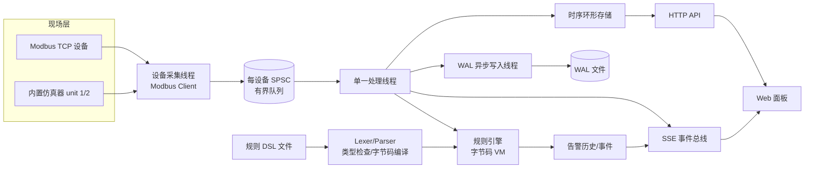

# EdgeGuard · 工业边缘数据采集与实时告警网关

一个无第三方依赖的 C++17 工程，模拟真实工业边缘软件的核心链路：

**Modbus TCP 采集 → 多线程解耦 → 实时规则告警 → 时序存储/WAL 恢复 → HTTP/SSE → Web 监控面板**

项目重点不是界面，而是完整可运行的系统设计：协议编解码、并发与背压、数据结构、编译原理、持久化、网络服务和测试。

> 本仓库已完成 Release 构建、18/18 测试、20 秒端到端验证和微基准；完整结果见 [docs/BENCHMARK.md](docs/BENCHMARK.md)。

---

## 1. 功能特性

- **Modbus TCP 设备采集**
  - 支持 Function 01/02/03/04：线圈、离散输入、保持寄存器、输入寄存器。
  - 支持 `u16 / i16 / u32 / f32 / bool` 解码、缩放、偏移和单位。
  - 自动按功能码与地址聚合为批量读取请求（最多 125 个寄存器 / 2000 个位）。
  - 每个设备独立采集线程、连接复用、超时、断线重连、指数退避。
- **内置 Modbus 仿真器**
  - 两个从站（unit 1/2），生成温度、压力、振动、流量、转速等连续数据。
  - 一条命令启动完整演示，不依赖真实 PLC/传感器。
- **自定义告警规则 DSL**
  - 手写词法分析器、递归下降语法分析器、AST、静态类型检查。
  - 编译为栈式字节码，由虚拟机执行；支持短路 `and/or`、括号、比较、算术和 `not`。
  - 支持告警去抖 `for`、滞回清除 `clear when ... for`，状态机自动产生触发/恢复事件。
  - 规则编译错误带行号、列号，`check` 子命令可输出字节码反汇编。
- **有界并发与背压**
  - 每个设备一个单生产者/单消费者无锁环形队列（SPSC）。
  - 采集线程与规则/存储处理线程解耦；队列满时计数并丢弃，保护采集实时性。
- **时序数据存储**
  - 每指标定长环形缓冲区，按时间保留 + 容量上限。
  - 查询支持时间范围与 min/max 峰值保持降采样。
- **WAL 崩溃恢复**
  - 自定义二进制 WAL：schema + sample 记录、CRC32 校验、定期 `fsync`。
  - 启动时重放；自动截断断电产生的半条记录（torn tail）。
- **HTTP + SSE 监控**
  - 原生 Socket 实现 HTTP/1.1 GET/HEAD、静态文件服务、路径穿越防护。
  - `/api/v1/stream` 使用 Server-Sent Events 推送实时样本和告警。
  - `web/index.html` 为纯原生 HTML/CSS/JS，零 CDN 依赖。
- **工程质量**
  - CMake 构建、CTest 测试、微基准命令、严格编译警告。
  - 18 个单元/集成测试用例，本次 Release 构建实测 18/18 通过，覆盖队列、协议、配置、DSL、规则状态机、存储、WAL。

---

## 2. 架构



### 线程模型

| 线程 | 数量 | 职责 |
|---|---:|---|
| 设备采集线程 | 每设备 1 个 | 建立连接、定时轮询、解码、投递样本 |
| 处理线程 | 1 个 | 批量消费队列、写时序存储与 WAL、执行规则、广播 SSE |
| WAL 写入线程 | 1 个 | 有界队列削峰、批量写盘、CRC、定期 fsync |
| HTTP 接受线程 | 1 个 | 接受连接、回收已完成的连接线程 |
| HTTP 连接线程 | 每连接 1 个 | 解析请求、API/静态文件/长连接 SSE |
| SSE 长连接 | 每客户端 1 个 | 有界事件队列、心跳、背压时丢旧事件 |

### 关键设计决策

| 问题 | 方案 | 原因 |
|---|---|---|
| 采集与处理速度不一致 | 每设备有界 SPSC 队列 | 避免共享锁；队列满时丢弃并计数，而不是阻塞采集 |
| 规则频繁变更/解释开销 | 编译为字节码再执行 | 词法/语法/类型错误在启动期暴露，热路径只做栈运算 |
| 告警抖动 | `for` + `clear when ... for` 状态机 | 连续满足持续时间才触发，恢复使用独立阈值和持续时间 |
| 时间序列查询点数过多 | min/max 分桶降采样 | 保留尖峰，控制图表数据量 |
| 断电恢复 | 二进制 WAL + CRC32 + 尾部截断 | 结构简单、可诊断、可恢复；损坏只影响未完整落盘部分 |
| 控制台实时刷新 | SSE | 比轮询简单，HTTP 原生支持，自动重连 |

---

## 3. 快速开始

### 环境要求

- C++17 编译器（GCC 9+ / Clang 10+ / MSVC 2019+）
- CMake 3.16+
- 无第三方库、无网络下载依赖

### Windows

如果是 Visual Studio 多配置生成器，可执行文件通常在 `build\Release\edgeguard.exe`：

```bat
cd edgeguard
cmake -S . -B build
cmake --build build --config Release
pushd build
ctest -C Release --output-on-failure
popd
build\Release\edgeguard.exe run --config configs\edgeguard.conf --with-simulator
```

如果使用 MinGW/Ninja 单配置生成器：

```bat
cmake -S . -B build -G "Ninja" -DCMAKE_BUILD_TYPE=Release
cmake --build build
build\edgeguard.exe run --config configs\edgeguard.conf --with-simulator
```

也可以直接运行 `scripts\run_demo.bat`（会先构建）。

### Linux / macOS

```bash
cd edgeguard
cmake -S . -B build -DCMAKE_BUILD_TYPE=Release
cmake --build build -j"$(nproc 2>/dev/null || echo 2)"
(cd build && ctest --output-on-failure)
./build/edgeguard run --config configs/edgeguard.conf --with-simulator
```

或使用 `bash scripts/run_demo.sh`（Linux/macOS；也可先 `chmod +x` 后直接执行）。

启动后打开：

```text
http://127.0.0.1:8080/
```

内置仿真器监听 `127.0.0.1:15020`，配置中的两台设备都指向它。演示数据大约数秒内就会跨越告警阈值，页面右侧会出现触发/恢复事件。

### 命令

```text
edgeguard run   [--config <path>] [--with-simulator] [--duration-ms <n>]
edgeguard sim   [--host <ip>] [--port <port>] [--duration-ms <n>]
edgeguard check [--config <path>] [--rules <path>] [--disasm]
edgeguard bench [--iterations <n>]
edgeguard --version
```

- `run`：启动完整网关；`--with-simulator` 以内嵌方式启动 Modbus 从站。
- `sim`：只启动仿真器，便于配合真实网关或 Modbus 调试工具。
- `check`：只做配置加载和规则编译，打印规则摘要；`--disasm` 输出字节码反汇编。
- `bench`：运行队列、VM、时序存储微基准。数字与 CPU/编译选项强相关，请以本机实测为准。
- `--duration-ms`：自动化演示/冒烟测试用，到时自动退出。

Windows 下按 `Ctrl+C` 优雅停止：停止采集、排空队列、刷新 WAL、关闭 HTTP。

---

## 4. 目录结构

```text
edgeguard/
├── CMakeLists.txt
├── configs/
│   └── edgeguard.conf          # 网关、设备、指标映射配置
├── rules/
│   └── line1.rules             # 告警规则 DSL
├── web/
│   └── index.html              # 原生 Web 监控面板
├── src/
│   ├── main.cpp                # CLI、信号处理
│   ├── app/application.*       # 组件编排、API、SSE、生命周期
│   ├── common/                 # 日志、配置、JSON、Socket、工具
│   ├── protocol/               # Modbus TCP 客户端/编解码/仿真器
│   └── core/
│       ├── metrics.*           # 指标注册表
│       ├── spsc_queue.h        # 无锁有界队列
│       ├── sample_bus.*        # 每设备队列 + 单消费者
│       ├── acquisition.*       # 轮询计划/解码/健康状态
│       ├── event_hub.*         # SSE 扇出
│       ├── rules/              # Lexer/Parser/Compiler/VM/状态机
│       ├── storage/            # 环形时序存储、WAL
│       └── http/               # HTTP/1.1 + 静态文件服务
├── tests/                      # 18 个 CTest 用例
├── scripts/                    # 一键演示脚本
└── docs/
    ├── ARCHITECTURE.md         # 详细设计
    ├── BENCHMARK.md            # 本次构建、测试、端到端与基准结果
    └── TECHNICAL_DISCLOSURE.md # 规则 DSL 与告警去抖技术交底
```

运行时会生成：

```text
data/edgeguard.wal   # 时序样本 WAL
logs/edgeguard.log   # 网关日志（同时输出控制台）
```

---

## 5. 配置

配置为 INI 风格，路径相对于配置文件所在目录解析，避免从不同工作目录启动时找不到文件。

```ini
[gateway]
http_host=127.0.0.1
http_port=8080
web_root=../web
wal_path=../data/edgeguard.wal
rules=../rules/line1.rules
retention_seconds=3600
max_points_per_metric=200000
per_device_queue_capacity=8192
batch_size=256
wal_queue_capacity=65536
wal_flush_interval_ms=200

[logging]
level=info
file=../logs/edgeguard.log

[acquisition]
default_poll_interval_ms=250

[simulator]
port=15020

[device.boiler_01]
display_name=1号锅炉
host=127.0.0.1
port=15020
unit_id=1
interval_ms=250
metrics=temp:holding:0:u16:0.1:0:℃;pressure:holding:1:u16:0.01:0:MPa;pump_on:coil:0:bool:1:0:
```

### 指标描述格式

```text
name:area:address:type:scale:offset[:unit]
```

| 字段 | 可选值 | 说明 |
|---|---|---|
| `area` | `holding` / `input` / `coil` / `discrete` | 对应 Modbus Function 03/04/01/02 |
| `type` | `u16` / `i16` / `u32` / `f32` / `bool` | `coil/discrete` 必须为 `bool` |
| `scale`, `offset` | 浮点数 | `physical = raw * scale + offset` |
| `unit` | 字符串 | 可为空；不要包含 `:` 或 `;` |

多个指标用 `;` 分隔。设备名和指标名支持字母、数字、下划线，规则 DSL 通过 `device.metric` 引用。

---

## 6. 规则 DSL

### 语法

```text
rule <name> "<title>" {
    when <boolean-expression>
    [for <duration>]
    [clear when <boolean-expression> [for <duration>]]
    emit {
        severity = <identifier|string>
        code = <identifier|string>
        message = <string>
    }
}
```

- 表达式支持：数字、布尔字面量、`device.metric`、`+ - * /`、`> >= < <= == !=`、`and or not`、括号。
- 时长支持：`ms`、`s`、`m`、`h`，最多 7 天。
- `for`：条件需要连续为真多久才触发。
- `clear when ... for`：激活后，清除条件连续满足多久才恢复；未提供时，条件变假立即恢复。
- 类型检查是静态的：数字不能与布尔直接比较，`and/or/not` 只接受布尔操作数，规则根表达式必须是布尔值。

示例（节选自 `rules/line1.rules`）：

```text
rule boiler_overheat "1号锅炉温度过高" {
    when boiler_01.temp > 85.0
    for 3s
    clear when boiler_01.temp < 80.0 for 3s
    emit {
        severity = critical
        code = BOILER_OVERHEAT
        message = "1号锅炉温度超过 85℃，请检查燃烧与循环系统"
    }
}
```

编译验证：

```bash
./build/edgeguard check --config configs/edgeguard.conf --disasm
```

### 编译执行链路

```text
源文件 → Lexer(带行列号) → 递归下降 Parser → AST
      → 指标解析 + 静态类型检查 → 栈式字节码
      → 规则状态机(去抖/滞回) ↔ 栈式 VM
      → AlarmEvent(raised/cleared)
```

字节码示例（部分）：

```text
0  LOAD_METRIC metric#0
1  PUSH_CONST 85
2  GT
3  JIF_FALSE -> 6
4  PUSH_CONST 0
5  JUMP -> 7
6  PUSH_CONST 1
7  ...
```

实现中用 `JIF_FALSE`/`JIT_TRUE` 完成短路求值；跳转回填保证代码生成的单遍性。

---

## 7. HTTP API

所有接口均为 `GET`，返回 JSON（SSE 除外）。HEAD 请求会返回相同响应头、不返回 body。

| 路径 | 说明 |
|---|---|
| `/` | Web 监控面板 |
| `/api/v1/health` | 版本、运行时长、在线设备、活动告警、WAL 写入/丢弃计数 |
| `/api/v1/overview` | 设备健康状态、队列深度、每指标最新值和采集时间 |
| `/api/v1/series?device=boiler_01&metric=temp&minutes=5&max_points=400` | 时序查询，支持 `from`/`to` 毫秒时间戳及降采样 |
| `/api/v1/alarms?limit=50` | 最近触发/恢复事件，附加活动告警数 |
| `/api/v1/rules` | 已编译规则、去抖参数、引用指标 |
| `/api/v1/stream` | SSE：`sample` / `alarm` / `ready` 事件，15 秒心跳 |

示例：

```bash
curl "http://127.0.0.1:8080/api/v1/series?device=boiler_01&metric=temp&minutes=5&max_points=200"
curl -N http://127.0.0.1:8080/api/v1/stream
```

安全边界：

- 静态文件服务做了路径规范化与目录穿越校验，但仅适合本机/受信 LAN 演示。
- 不提供认证、TLS、写接口；生产环境应置于反向代理后面并补充鉴权。

---

## 8. WAL 格式

文件头：

```text
magic "EDGEWAL1" (8B) | version LE u32 (4B)
```

记录：

```text
type u8 | payload_length LE u32 | payload | crc32 LE u32
```

- `type=1` schema：`metric_id u32 | name_length u16 | metric_key bytes`
- `type=2` sample：`metric_id u32 | timestamp i64 | double bits u64`
- CRC32 覆盖 `type + length + payload`。
- 恢复时按记录边界扫描；任一记录长度越界、CRC 不符或文件尾部不足一条完整记录，即认为尾部撕裂（例如断电），保留之前完整记录并将文件截断至最后一个完整记录边界。
- WAL 写入在独立线程中异步完成，`flush_interval_ms` 控制刷盘/fsync 频率。

启动恢复策略：

1. 加载配置和当前指标注册表。
2. 重放 WAL，把 `metric_key` 映射回本次启动的指标 id，只恢复保留期内的样本。
3. 创建 `WalWriter` 从文件末尾继续追加。

---

## 9. 测试与基准

```bash
(cd build && ctest -C Release --output-on-failure)
./build/edgeguard bench --iterations 1000000
```

测试覆盖：

- SPSC 环形队列：容量、回绕、满/空、跨线程顺序。
- 配置：指标解析、路径解析、未知键/缺失字段报错。
- Modbus：MBAP/PDU 编解码、异常响应、位解码、真实 TCP 仿真器集成。
- 规则：词法/语法错误、静态类型检查、短路求值、去抖、滞回、恢复再触发、引用指标未齐时不误报。
- 存储：容量淘汰、按时间保留、min/max 降采样。
- WAL：缺失文件、写入/恢复、撕裂尾部截断、恢复后继续追加。

`bench` 输出三项本机微基准：

- SPSC 队列吞吐（Mmsg/s）
- 规则 VM 条件求值吞吐（Meval/s）
- 时序存储追加吞吐（Msample/s）

### 本次本机实测

环境：AMD Ryzen 7 7840H / Windows 11 / GCC 16.2.0 / CMake 4.4.3 / Ninja / Release `-O3`。

- 构建：成功，无编译错误。
- 测试：18 passed, 0 failed, 18 total。
- 端到端 20 秒：2 设备在线，536 样本处理，温度/压力告警触发并恢复，SSE 收到 `ready/sample/alarm`，重启 WAL 恢复 536 样本。
- 微基准（1,000,000 iterations，干净重建后连续 3 次中位数）：
  - SPSC：**132.03 Mmsg/s**
  - 规则 VM：**28.58 Meval/s**
  - 时序追加：**74.10 Msample/s**

完整方法、原始三次数据和测试边界见 [docs/BENCHMARK.md](docs/BENCHMARK.md)。这些是单机微基准，不代表生产现场端到端吞吐；对外引用时应同时注明 Release、迭代次数和硬件/编译器条件，不要把微基准描述为未经验证的端到端并发能力。

---

## 10. 已知限制与可继续演进

- 当前每个规则产生一个告警实例；如果要按设备批量套用同一规则，可增加规则模板/实例展开。
- HTTP 采用每连接一个线程，适合边缘单机/少量客户端；高并发可替换为 epoll/IOCP reactor。
- WAL 单文件追加，未实现分段滚动与压缩；长期运行应增加 segment + retention GC。
- 规则文件变更需重启生效；可增加配置热加载与双缓冲规则切换。
- 告警历史保存在内存中（最多 500 条），WAL 只持久化样本；重启后告警历史和规则激活状态会重置，但最近时序数据可恢复。
- 无鉴权/TLS；生产部署需要网关鉴权、审计与 mTLS。
- 时序存储是内存优先，重启仅恢复 WAL 保留期内的数据；可增加 parquet/列式归档和聚合表。
- Modbus 只实现常见只读功能码；真实项目可扩展设备模板、串口 RTU、字节序配置、写回控制与设备发现。
- 仿真器仅用于开发/演示，不可用于生产。
