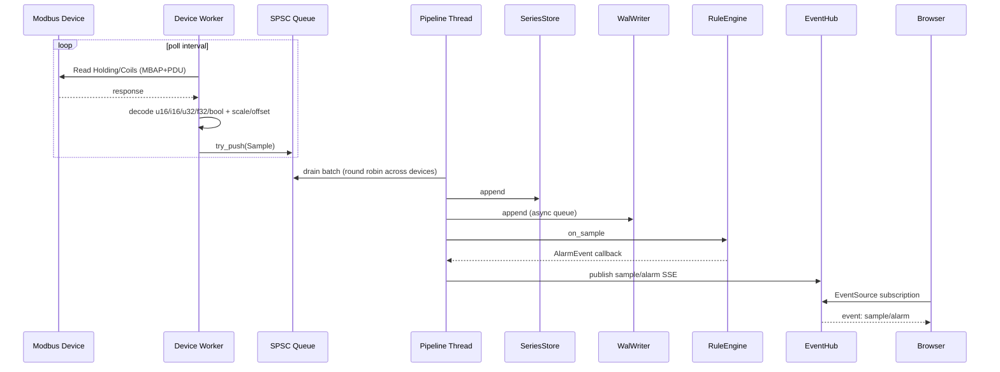
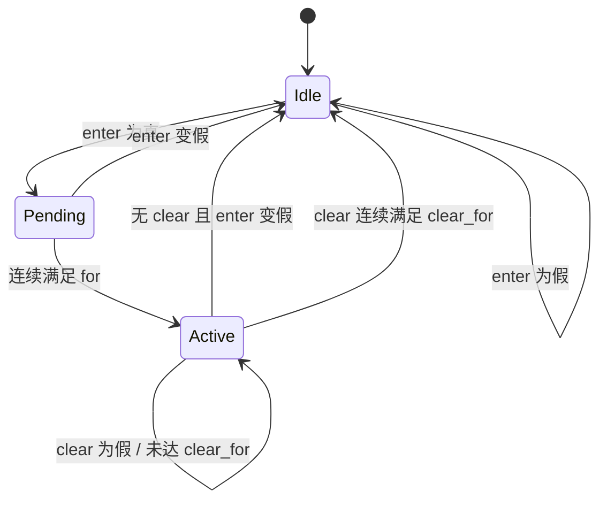

# EdgeGuard 架构设计

本文记录关键模块的接口、数据流、并发模型和设计取舍。

## 1. 目标与非目标

**目标**

- 在单台边缘网关上稳定采集多台 Modbus TCP 设备。
- 采集、规则判断、持久化互不阻塞。
- 规则可配置、可静态检查、重复执行开销低。
- 断电后能恢复最近一段时序数据，且损坏尾部可自动处理。
- 提供一个可直接演示的本地 Web 面板。
- 只用标准库和操作系统 API，降低构建门槛。

**非目标**

- 不是完整 SCADA/IIoT 平台：没有设备编排、用户权限、多租户、集群。
- 不是生产级 Web 服务器：没有 TLS、epoll/IOCP、HTTP/2。
- 不实现 Modbus 写操作、RTU、设备自动发现。
- 不追求极端容量；单进程、单节点、本地文件。

明确非目标比堆功能更能体现工程判断。

## 2. 数据流



每个设备样本共享同一个采集时间戳。这样同一轮采集的多个指标在图表和规则中时间对齐，定时持续时间也按设备采样时间推进。

## 3. 采集层

### 3.1 Modbus 编解码

- MBAP 头：transaction id、protocol id、length、unit id。
- TCP 客户端维护 transaction id，每次请求递增；校验响应事务号、unit id、function code。
- 部分读取/粘包处理：先读 6 字节 MBAP 前缀，再按 length 字段读剩余 body。
- 协议异常（`function | 0x80`）会转换为 `ModbusError`，由采集线程捕获并断线重连。
- 客户端一次只被一个采集线程使用，因此事务号与 Socket 不需要加锁。
- 字节序：寄存器按 Modbus 大端；`u32/f32` 使用高字在前。真实项目常需要“字交换”，当前未做配置化。

### 3.2 轮询计划

设备配置中每个指标包含 function、地址、类型和宽度。初始化时：

1. 按 function code 和地址排序指标。
2. 把地址跨度不超过协议上限（寄存器 125、线圈 2000 位）的指标合并到同一个读块。
3. 对每个读块发起一次请求，再按 `address - block.start` 解码各指标。

这样可以减少请求次数；即使指标间有小空洞，也会读到空洞地址，属于吞吐/请求数之间的合理折中。读块内的任何请求失败都会让本轮采集失败，不发布部分样本，避免时间序列出现“半轮”数据。

### 3.3 失败与退避

- 每次读取前记录 `last_attempt`，成功后记录 `last_sample` 并清除错误。
- 失败时关闭连接、累计错误、指数退避（上限 30 秒或 8 倍轮询周期）。
- 日志在首次失败和每 20 次失败时打印，避免设备长时间离线时刷屏。
- 再次成功后打印恢复日志。
- 健康状态通过原子变量 + 单指标错误字符串互斥锁暴露给 HTTP 线程。

## 4. 并发模型与背压

### 4.1 SPSC 队列

`SpscQueue<T>` 是固定容量、容量向上取 2 的幂的环形缓冲区：

- 生产者只写 `head_`，消费者只写 `tail_`。
- 写数据后用 release store 发布 `head_`；读者 acquire load `head_` 后再读槽位。
- 满时 `try_push` 返回 false，不阻塞。
- 消费者是自己的唯一读者，因此无需 CAS；两个原子变量分别 alignas(64) 减少伪共享。

每个设备一个队列，由唯一的设备采集线程生产，指定的处理线程消费，满足 SPSC 前提。

### 4.2 单消费者调度

`SampleBus::drain` 在一轮里对所有设备队列做轮转弹出，默认最多取 `batch_size` 个样本。这样：

- 慢设备不会在每次 drain 时被快设备饿死。
- 处理线程一次处理一批，摊薄条件变量唤醒与 WAL 入队开销。
- 队列满时丢弃最新样本并计数（`dropped`），而不是反向阻塞采集。

**为什么选择丢弃最旧/满即丢？** 边缘采集更看重“当前值”而不是无限积压；丢样本通过指标暴露，便于诊断。处理端持续过载时，应扩容/降采样，而不是让采集延迟无限增长。当前实现是队列满拒绝新样本并计数，等价于丢新样本；WAL 队列满则丢最旧样本以保留最新趋势。两者都在 API/日志中可观察。

### 4.3 生命周期

- 处理线程只在 `bus.close()` 后把所有队列排空再退出，避免停机丢数据。
- 停机顺序：`acquire.stop → simulator.stop → bus.close → pipeline.join → http.stop → events.close → wal.stop`。
- SSE 长连接由应用层 `stopping_` 标志 + HTTP Server 的 stop 标志双重检查，每 500ms 醒来一次；HTTP 停止时可以及时 join 连接线程。
- WAL 写入线程由 `stop` 排空队列后 join，最后 `fflush + fsync`。

## 5. 规则 DSL 与运行时

### 5.1 编译流水线

```text
source
  → lexer: Token{kind,text,line,col}
  → parser: AST（递归下降 + 优先级分层）
  → type checker: 指标存在性、Number/Boolean 类型规则
  → code generator: 栈式字节码 + 回填跳转
  → immutable RuleProgram
  → RuleEngine: 状态机 + VM
```

表达式优先级从低到高：

```text
or
and
== !=
< <= > >=
+ -
* /
unary not / -
primary: number | bool | device.metric | (expr)
```

### 5.2 字节码与 VM

- 值栈使用 `double`；布尔用 0/1，类型在编译期已确定。
- `LOAD_METRIC` 的 operand 是全局指标 id。
- 算术/比较/`NOT`/`NEG` 直接对栈顶操作。
- `and`/`or` 编译为短路跳转：

```text
# left and right
<left>
JIF_FALSE false_label
<right>
JUMP end_label
false_label: PUSH_CONST 0
end_label:
```

`JIF_FALSE` / `JIT_TRUE` 弹出条件值，因此每个分支结束时栈上只留下一个结果。`max_stack` 由 AST 递归计算，在启动期确定，VM 预留栈容量。

### 5.3 类型检查

- 指标类型来自配置：`bool` 指标是 Boolean，其余是 Number。
- 算术和大小比较要求 Number；相等比较要求两边同类型；`and/or/not` 要求 Boolean。
- 规则根表达式必须是 Boolean。
- 所有检查在启动时执行；运行时不抛类型异常，只执行已知合法指令。

### 5.4 告警状态机

每个规则实例维护：

```text
pending / pending_since
active / clearing / clearing_since
```

状态图：



设计细节：

- 持续时间使用**样本时间戳**，而不是墙钟，因此测试可精确控制、离线重放可复现。
- 恢复可以配置独立阈值（滞回），避免在阈值附近抖动。
- 只有规则的某个引用指标更新时才评估；所有引用指标都至少有一个样本后才评估，防止启动初期缺值导致误报。
- 规则激活期间不会重复触发；恢复后条件再次满足会重新触发。
- `trigger_metric` 记录本轮触发评估的样本，便于排查；一个规则可以引用多个设备/指标。

## 6. 时序存储

### 6.1 环形缓冲

- 每指标一个 `vector<StoredPoint>` + `start/count` 索引，容量由 `max_points_per_metric` 限制。
- 新样本超过保留期时从头部淘汰；容量满时覆盖最旧点。
- 时间戳单调处理：若系统时钟回拨，把样本时间戳夹到最后时间戳，保证查询顺序。
- 每个序列独立互斥锁，追加与查询可并发；HTTP 查询不会阻塞其他指标。

### 6.2 降采样

查询时先收集区间内点。若超过 `max_points`：

- 目标桶数 = `max_points / 2`。
- 每桶输出最小值、最大值（按时间排序，去重）。
- 这样保留尖峰/谷值，适合异常排查；比等间隔抽样更不容易漏掉瞬时告警。

### 6.3 恢复与边界

- WAL 重放样本进入同一存储，旧于保留期的记录直接过滤。
- 存储不区分“实时/恢复”来源；HTTP 读取统一。
- 进程重启后，规则不重放历史样本，只从新样本重建规则状态，避免历史告警在启动时被重复触发。

## 7. WAL 持久化

### 7.1 写路径

- 处理线程调用 `WalWriter::append` 只做有界队列入队，不直接写磁盘。
- WAL 线程批量取最多 2048 条，逐条记录写文件，按 `flush_interval_ms` 定期 `fflush + fsync`。
- 队列满时丢最旧样本，计入 `dropped`，保证写入线程不会反向拖死处理线程。
- 每个指标首次出现时写 schema 记录，后续只写 sample 记录；schema 使恢复不依赖启动参数顺序或指标 id 稳定。

### 7.2 恢复路径

- 检查 magic/version。
- 循环读取 `[type][len][payload][crc]`，CRC32 校验。
- 任何长度越界、未知类型或 CRC 失败，都视为尾记录损坏，停止并截断到最后一个完整记录。
- schema 表在本次扫描内维护 `old_id → metric_key`；sample 记录通过 key 映射回当前配置的指标 id。
- 不完整的头（文件小于 12 字节）直接截断为空文件；magic 不正确则报错而不是覆盖，避免误删未知文件。

### 7.3 为什么不直接上 SQLite？

这个项目需要演示并验证数据结构、协议和崩溃恢复能力；自研精简 WAL 能完整控制记录格式、CRC、torn-tail 行为。生产版本应优先评估成熟存储引擎或时序数据库，而不是为了重复造轮子。

## 8. HTTP 与 SSE

- 每个客户端连接一个线程，读请求超时 2 秒，发送超时 5 秒（SSE 2 秒）。
- 接受线程每 200ms 轮询 accept，并回收已完成连接线程，避免线程对象无限累积。
- 请求解析只接受 GET/HEAD；限制请求头 16KB；路径进行百分号解码并拒绝 `..`、反斜杠、空字节。
- 静态文件使用 `weakly_canonical` 解析真实路径，再做根目录前缀校验，防止目录穿越（符号链接也被限制在 root 内）。
- SSE 每个订阅者有独立有界队列，最多 512 个事件；慢客户端丢弃最旧事件，不阻塞采集/规则线程。每 15 秒发送注释心跳。
- `EventHub` 的锁顺序固定为 hub mutex → subscriber mutex；等待使用时不会持有 hub mutex，避免死锁。

## 9. 测试策略

| 层 | 方式 | 目的 |
|---|---|---|
| 纯函数 | CRC、时长、JSON、配置 | 快速定位基础错误 |
| 数据结构 | SPSC 单线程边界 + 双线程传输 | 验证回绕、满/空、内存序使用 |
| 协议 | 手工构造 MBAP/PDU + 本地 TCP 仿真器 | 验证字节序、事务匹配、异常码、重连 |
| 编译器 | 合法/非法 DSL、类型错误、字节码执行 | 验证优先级、短路、诊断位置 |
| 规则运行时 | 按时间戳驱动样本序列 | 验证去抖、滞回、再触发、缺值不误报 |
| 存储 | 容量/保留期/降采样 | 验证环形覆盖和时间窗口 |
| WAL | 写入→恢复、尾部垃圾注入 | 验证 CRC 与自动截断 |

测试使用自建轻量 harness，不引入测试框架依赖，CTest 统一执行。

## 10. 权衡与演进路线

1. **HTTP 线程模型**：当前线程-per-connection 易理解、易调试，但连接数大时开销明显。下一步可用单线程 `select/poll` reactor（Windows 用 WSAEventSelect）或 epoll/IOCP。
2. **WAL 分段**：单文件长期增长，缺少 segment 滚动/GC；可在文件头增加段号、写入时切换、启动时按段恢复。
3. **规则热更新**：当前规则只读；可用 RCU/双缓冲发布新的 `RuleProgram`，处理线程按 epoch 安全切换。
4. **采集侧扩展**：设备模板、批量块合并优化、RTU、字节序/字序配置、写回与互锁。
5. **可观测性**：增加 Prometheus `/metrics`、采集延迟直方图、规则执行耗时、WAL fsync 延迟。
6. **安全**：反向代理 + TLS、管理员鉴权、API 审计、规则文件签名。
7. **规模**：从单机多设备扩展到多网关；指标存储替换为列式时序库，中心侧汇聚。

## 11. 关键设计问答

- 为什么不用一个共享队列？→ 多生产者需要 CAS/锁，单消费者公平性与热路径复杂度；每设备队列让每个设备只有一个生产者，能使用更轻的 SPSC，并且按设备独立背压/诊断。
- `head_/tail_` 的 acquire/release 如何保证槽位可见？→ 写槽位后 release store head，消费者 acquire load head 才读；反过来 tail 的 release/acquire 让生产者复用槽位。索引用单调递增计数 + 掩码，避免 ABA 和 head==tail 二义性。
- 为什么用 AST→字节码而不是直接解释 AST？→ 规则条件每个采集周期执行多次；字节码减少遍历与虚分发，错误在启动期暴露，可做反汇编与优化。
- 短路编译如何保持栈平衡？→ 条件跳转弹出左值，两个分支各留下一个结果；代码生成器回填跳转目标，栈最大深度启动期计算。
- 持续时间为啥用样本时间？→ 可测试、可重放；避免墙钟漂移；代价是设备停更时告警不会自行推进，这符合数据驱动语义。
- WAL 如何判断半条记录？→ 先校验完整 header/长度/payload/CRC；任何读取不足或 CRC 失败即认为尾部不完整，截断到最后一个完整记录的偏移。
- 如何避免 SSE 慢客户端拖垮系统？→ 每订阅者有界队列 + 丢旧事件 + 独立发送线程；发送失败直接断开。
- 这个项目的不足？→ 见上节，能说出取舍比“全都完美”更可信。
